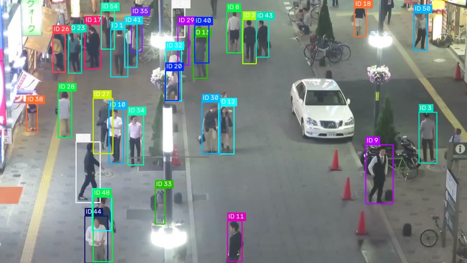
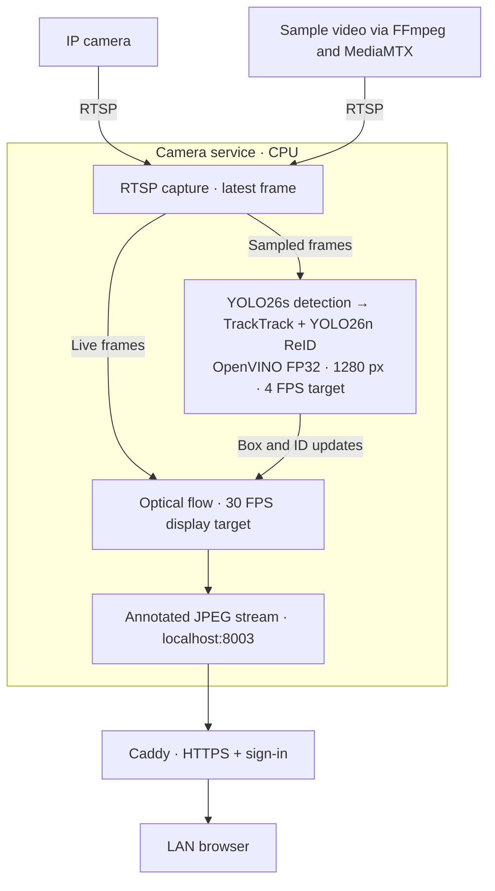

# FastMOT

FastMOT tracks pedestrians from an IP camera on a CPU and shows live bounding boxes and track IDs in a browser. It also processes recorded video from the command line.

[Quick start](#quick-start) · [Architecture](#architecture) · [LAN deployment](deploy/camera/README.md)

## Tracking demo

[](deploy/video/tracking-demo.mp4)

[Watch the 10-second MP4](deploy/video/tracking-demo.mp4), captured from the live viewer stream using the [MOT17-04 sample clip](https://motchallenge.net/data/MOT17/).

## Architecture



The tracking pass assigns IDs and corrects boxes. Optical flow moves those boxes between tracking passes so the image and overlay can update together at the source frame rate, up to 30 FPS. The browser reports tracking and display FPS separately.

## Quick start

### CPU setup

From the repository root on Linux with Python 3.11:

```bash
python -m venv .runtime/venv
source .runtime/venv/bin/activate
pip install torch torchvision --index-url https://download.pytorch.org/whl/cpu
pip install -r requirements.txt
```

The OpenVINO detector and ONNX ReID weights are included in [`weights/`](weights/).

### Connect an IP camera

Save the camera's RTSP URL in `.runtime/camera/rtsp-url` with file permissions `0600`. Use a camera account with viewing access. Follow the [RTSP credential setup](deploy/camera/README.md#1-chạy-với-camera-ip) for the commands.

```bash
python scripts/web_tools/serve_camera.py --rtsp-url-file .runtime/camera/rtsp-url
```

Open [localhost:8003](http://127.0.0.1:8003) on the host. For access from another machine on the LAN, follow the [systemd and Caddy deployment guide](deploy/camera/README.md#3-chuẩn-bị-triển-khai).

### Simulate a camera

Install FFmpeg and put MediaMTX on your `PATH`. The script publishes the included clip over localhost RTSP and tests reconnection.

```bash
python scripts/web_tools/verify_camera.py \
  --mediamtx "$(command -v mediamtx)" \
  --fixture deploy/video/fixture.mp4 \
  --seconds 60 --output outputs/camera_sim
```

Open [localhost:8003](http://127.0.0.1:8003) when the terminal prints `Viewer is live`. Choose a new output directory for each run.

## Process a recorded video

```bash
python scripts/inference/run_tracking.py \
  --source path/to/video.mp4 \
  --model-config configs/models/yolo26s_1280_openvino_fp32.json \
  --output outputs/runs/my_video
```

The output directory contains `tracking.mp4` with boxes, IDs, and short trajectories, plus `tracks.txt` (MOTChallenge), `tracks.jsonl`, and `summary.json`.
