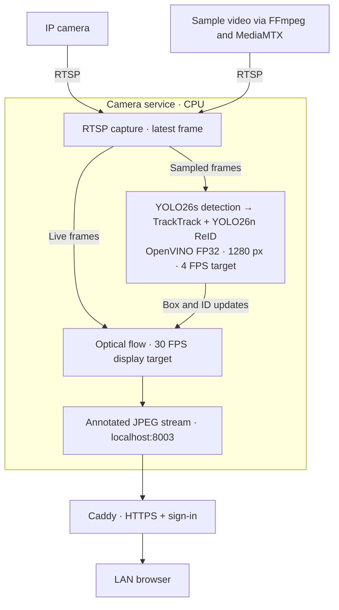

# FastMOT

FastMOT tracks pedestrians from an IP camera on a CPU and shows live bounding boxes and track IDs in a browser. It also processes recorded video from the command line.

[Quick start](#quick-start) · [Architecture](#architecture) · [Deployment](deploy/camera/README.md)

## Tracking demo


## Architecture



## Quick start

### CPU setup

From the repository root on Linux with Python 3.11:

```bash
python -m venv .runtime/venv
source .runtime/venv/bin/activate
pip install torch torchvision --index-url https://download.pytorch.org/whl/cpu
pip install -r requirements.txt
```

### Connect an IP camera

Save the camera's RTSP URL in `.runtime/camera/rtsp-url` with file permissions `0600`. Use a camera account with viewing access. Follow the [RTSP credential setup](deploy/camera/README.md#1-chạy-với-camera-ip) for the commands.

```bash
python scripts/web_tools/serve_camera.py --rtsp-url-file .runtime/camera/rtsp-url
```

### Simulate a camera

Install FFmpeg and put MediaMTX on your `PATH`. The script publishes the included clip over localhost RTSP and tests reconnection.

```bash
python scripts/web_tools/verify_camera.py \
  --mediamtx "$(command -v mediamtx)" \
  --fixture deploy/video/fixture.mp4 \
  --seconds 60 --output outputs/camera_sim
```

## Process a recorded video

```bash
python scripts/inference/run_tracking.py \
  --source path/to/video.mp4 \
  --model-config configs/models/yolo26s_1280_openvino_fp32.json \
  --output outputs/runs/my_video
```