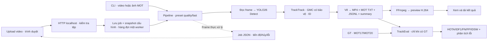
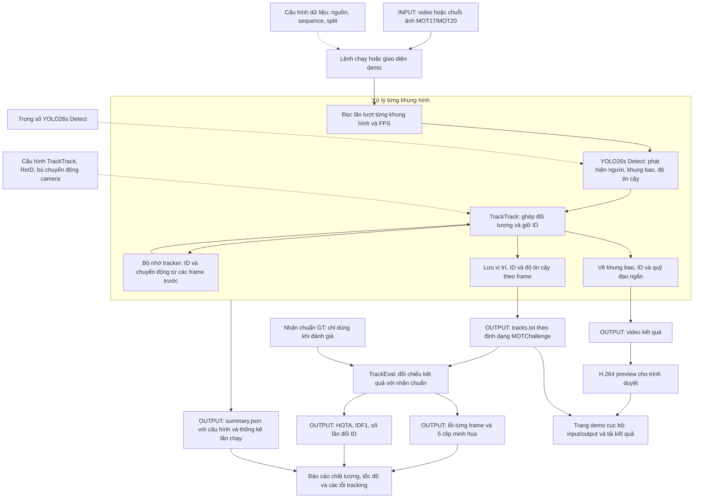

# Sơ đồ và cấu trúc toàn hệ thống MOT

Thiết kế đích theo [PROJECT_PLAN.md](../PROJECT_PLAN.md), cập nhật 18/11/2026. Phạm vi: một camera, người đi bộ, YOLO26s Detect + TrackTrack.

V2 bổ sung web app upload và xử lý video thật trên máy, dùng chung pipeline với CLI. Trang hai demo và bộ kết quả toàn MOT17 cũ được giữ riêng như đầu ra V1. Inference chạy trong Python, trình duyệt tải video kết quả H.264.



Tệp mới của V2:

- `src/mot/tracking/motion.py`: phát hiện frame thiếu tín hiệu/chuyển cảnh mạnh, kiểm tra warp GMC và reset track không dùng lại ID.
- `src/mot/tracking/replay.py` và `src/mot/evaluation/failure_analysis.py` hỗ trợ tìm tham số từ cache và giải trình FN/FP.
- `src/mot/app/` quản lý job, API localhost và giao diện upload, tiến độ, hủy, preview, tải file.
- `configs/profiles/`, `configs/runtime/`: hai preset và tùy chọn bảo vệ GMC/số luồng/capture. Model/tracker V2 có tệp riêng; các tệp gốc V1 được giữ nguyên.
- `scripts/experiments/` chạy và chọn cấu hình trên tập phát triển, đo tốc độ và đóng băng cấu hình.
- `scripts/scoring/` chấm GT, phân tích lỗi và đối chiếu sáu tiêu chí.
- `scripts/web_tools/` khởi động app, kiểm tra HTTP và tạo lại hai demo.
- `outputs/improvements/`: baseline/candidate, tìm tham số, regression, benchmark, cấu hình đóng băng, kết quả MOT20 và nghiệm thu. `outputs/web_jobs/<id>/` chứa input, `configs/`, `job.json` và `result/` của từng lần upload.

## 1. Luồng từ input đến output



- YOLO26 trả lời người đang ở đâu; TrackTrack nối người đó với ID trong lịch sử.
- Trạng thái tracker được giữ giữa các frame và reset khi đổi video.
- Hai khối detection/tracking là hai nhiệm vụ logic. Mã hiện dùng một lệnh `model.track(..., persist=True)` của Ultralytics để thực hiện cả hai; không cần gọi detector hai lần cho mỗi frame.
- Nhãn chuẩn không đi vào bước dự đoán ID. Video người dùng không có nhãn vẫn chạy được tracking, nhưng không chấm HOTA/IDF1.
- FPS được đo trong pipeline sau warm-up detector, tính đọc frame, tracking, vẽ và ghi kết quả/video. `summary.json` ghi phạm vi đo, phần cứng và độ trễ; TrackEval chấm chất lượng từ tệp MOT.
- Đánh giá chỉ dùng cửa sổ frame đã chạy, sao chép GT/metadata vào thư mục kết quả và bật tiền xử lý pedestrian. Dữ liệu gốc không bị chỉnh sửa.

## 2. Cấu trúc folder/file

Cây dưới đây liệt kê các tệp trong `scripts/`, `src/` và những đầu vào, đầu ra chính.

```text
MOT/
├── README.md                       # Cài đặt và các lệnh chạy
├── PROJECT_PLAN.md                 # Mục tiêu, các bước và tiêu chí hoàn thành
├── requirements.txt                # Phiên bản thư viện đã khóa cho môi trường CPU
├── .gitignore                      # Bỏ qua dữ liệu, trọng số, kết quả và cache
│
├── docs/
│   ├── ARCHITECTURE.md              # Sơ đồ và định nghĩa cấu trúc này
│   ├── DEMO.md                     # Xem/tạo demo, chạy video riêng và xử lý lỗi
│   └── REPORT.md                   # Baseline, cải thiện, tập giữ lại và kiểm chứng demo
│
├── configs/
│   ├── datasets/
│   │   └── mot17.json              # Đường dẫn dữ liệu, sequence chạy thử và split
│   ├── models/
│   │   ├── yolo26s.json            # Model mặc định, nguồn/SHA và cấu hình inference
│   │   └── yolo26s_baseline.json   # Model/inference baseline bước 4 được giữ nguyên
│   ├── experiments/
│   │   ├── mot17_step5.json        # Cửa sổ phát triển, thứ tự và thay đổi từng phép thử
│   │   ├── mot17_step5_confirmation.json # Kiểm tra thêm, chọn và đóng băng trước đánh giá cuối
│   │   └── mot17_selected.json     # Quyết định chọn mặc định, metric phát triển và checksum
│   └── trackers/
│       ├── tracktrack.yaml         # Tham số tracking mặc định sau bước 5
│       └── tracktrack_baseline.yaml # Tham số baseline bước 4 được giữ nguyên
│
├── src/
│   └── mot/
│       ├── __init__.py
│       ├── tracking/
│       │   ├── __init__.py
│       │   ├── detection.py        # Chạy YOLO riêng, lưu detection
│       │   ├── pipeline.py         # Chạy YOLO + TrackTrack, xuất video và track
│       │   ├── motion.py           # Bảo vệ GMC, xử lý frame đen và chuyển cảnh
│       │   ├── replay.py           # Chạy lại TrackTrack từ cache
│       │   ├── sources.py          # Đọc video hoặc chuỗi ảnh MOT
│       │   ├── mot_io.py           # Xuất MOT TXT và chuẩn hóa tọa độ
│       │   ├── visualization.py    # Vẽ khung bao, ID và quỹ đạo
│       │   └── smoke.py            # Chạy mẫu MOT17 để kiểm tra môi trường
│       ├── evaluation/
│       │   ├── __init__.py
│       │   ├── metrics.py          # Gọi TrackEval, lưu điểm theo sequence và gộp
│       │   ├── diagnostics.py      # Đối chiếu lỗi CLEAR và cắt clip
│       │   └── failure_analysis.py # Phân tích FN/FP từ detection và GT
│       └── app/
│           ├── __init__.py
│           ├── jobs.py             # Hàng đợi, tiến độ, hủy và lưu trạng thái
│           ├── web.py              # API localhost và phục vụ giao diện
│           ├── webui/              # index.html, app.js, style.css
│           ├── demo.py             # Tạo clip demo và chuyển preview sang H.264
│           └── demo.html           # Template của trang demo
│
├── scripts/
│   ├── setup/
│   │   ├── check_setup.py          # Kiểm tra môi trường và dữ liệu
│   │   └── smoke_test.py           # Chạy ngắn trên MOT17
│   ├── inference/
│   │   ├── run_detection.py
│   │   ├── run_tracking.py
│   │   └── run_mot17.py            # Chạy batch, resume và xuất MOT TXT theo từng hậu tố
│   ├── scoring/
│   │   ├── evaluate.py
│   │   ├── evaluate_external.py    # Chấm MOT20 từ cấu hình đã đóng băng
│   │   ├── analyze_failures.py
│   │   └── verify_improvements.py
│   ├── experiments/
│   │   ├── capture_diagnostics.py
│   │   ├── search_tracking.py
│   │   ├── tune_tracking.py
│   │   ├── benchmark_profiles.py
│   │   └── freeze_profiles.py
│   └── web_tools/
│       ├── serve_app.py
│       ├── verify_app.py
│       └── prepare_demo.py
│
├── tests/
│   ├── test_detection.py           # Kiểm tra nguồn ảnh/video, confidence và export
│   ├── test_tracking.py            # Vòng đời ID, frame trống, quỹ đạo và reset nguồn
│   ├── test_evaluation.py          # MOT, metric, GT đoạn ngắn, distractor và clip
│   ├── test_tuning.py              # Chặn tập giữ lại, một thay đổi và quy tắc xếp hạng
│   ├── test_demo.py                # Đóng gói hai clip, snapshot, liên kết và tránh ghi đè
│   └── test_batch.py               # Đủ train/test, ảnh trùng mọi frame và điều kiện dùng lại run
│
├── data/
│   ├── MOT17/                      # Dataset gốc: ảnh, metadata, nhãn chuẩn
│   ├── MOT17Labels/                # Bộ nhãn đã tải riêng, được giữ nguyên
│   └── MOT20/                      # Dữ liệu cảnh đông dùng để đánh giá ngoài MOT17
│
├── weights/
│   └── yolo26s.pt                  # Trọng số Detect, không chứa mã nguồn
│
├── outputs/
│   ├── checks/
│   │   └── setup_report.json       # Kết quả kiểm tra môi trường và dữ liệu
│   ├── runs/
│   │   ├── detect_mot17_09/         # Detection bước 2: video, JSONL, preview, summary
│   │   ├── track_mot17_09/          # Kết quả bước 3 trước khi thêm đo tốc độ/MOT
│   │   ├── baseline_mot17_09/       # Chạy lại ở bước 4; tương tự baseline_mot17_04
│   │   │   ├── tracking.mp4         # Video có ID và quỹ đạo
│   │   │   ├── tracks.jsonl         # Vị trí/ID/độ tin cậy của từng frame
│   │   │   ├── summary.json         # Cấu hình và thống kê lần chạy
│   │   │   └── tracks.txt           # Kết quả MOTChallenge, frame/tọa độ gốc 1
│   │   └── smoke_test/             # Hiện có; mỗi lần chạy đầy đủ sẽ dùng tên riêng
│   │       ├── preview.mp4         # Video có khung bao và ID
│   │       ├── frame_000001.jpg    # Ảnh preview đầu đoạn
│   │       ├── frame_000100.jpg    # Ảnh preview cuối đoạn mặc định 100 frame
│   │       └── summary.json        # Cấu hình, trọng số và thống kê lần chạy
│   ├── experiments/                # Kế hoạch, cấu hình, run và metric từng phép thử
│   ├── mot17_full/
│   │   ├── index.html              # Trang xem toàn bộ video đã hoàn tất
│   │   ├── manifest.json           # Tiến độ, SHA ảnh, xuất xứ run dùng lại và thống kê
│   │   ├── configs/                # Snapshot model/tracker dùng chung cho cả lượt chạy
│   │   ├── train/                  # 7 sequence không lặp; mỗi sequence có video/MOT/JSONL
│   │   ├── test/                   # 7 sequence không lặp; không có GT cục bộ
│   │   ├── motchallenge/           # TXT theo cả 3 hậu tố, train.zip và test.zip
│   │   └── evaluation_train/       # Metric toàn bộ train, gồm cả phát triển và giữ lại
│   ├── demo/
│   │   ├── index.html              # Trang xem kết quả cục bộ
│   │   ├── manifest.json           # Nguồn clip, phạm vi frame và FPS của demo
│   │   ├── configs/                # Snapshot model/tracker thực chạy
│   │   ├── street/                 # Video input và result/ của MOT17-09
│   │   └── crowd/                  # Video input và result/ của MOT17-04
│   └── evaluations/
│       └── baseline_mot17/
│           ├── metrics.json        # Metric, FPS, phần cứng và phạm vi frame/split
│           ├── inputs/             # GT/metadata sao chép và prediction dùng để chấm
│           ├── trackeval/          # Summary và CSV chi tiết của evaluator
│           ├── *_errors.json       # FN/FP/IDSW từng frame
│           └── error_clips/        # 5 video/ảnh lỗi và index.json
│
└── .runtime/                       # Cache và thiết lập tạm của thư viện
```

## 3. Trách nhiệm và ranh giới

- **`scripts/` là cửa vào:** nhận tham số dòng lệnh, gọi phần xử lý phù hợp. `run_tracking.py` gọi pipeline; `smoke_test.py` gọi bài kiểm tra ngắn trong `smoke.py`.
- **`src/mot/tracking/pipeline.py` điều phối:** nạp model, warm-up, dùng bộ đọc nguồn chung, giữ TrackTrack xuyên suốt nguồn, ghi video/JSONL/MOT và đo tốc độ. Mỗi lần gọi tạo model/tracker mới, tránh chia sẻ ID giữa các video.
- **`detection.py` chạy bước 2:** gọi `model.predict`, chỉ lấy người, kiểm tra tọa độ ảnh gốc, lưu toàn bộ detection và video hiển thị. Không tạo tracker hay dùng GT.
- **`sources.py` cung cấp frame:** ảnh và thông tin FPS/kích thước, không dự đoán đối tượng.
- **`visualization.py` phục vụ hiển thị:** vẽ từ kết quả tracking, giữ tối đa 30 frame lịch sử và không nối đường qua frame thiếu quan sát. Không thay đổi ID để làm video đẹp hơn.
- **`mot_io.py` chuẩn hóa dữ liệu:** ghi `frame,id,left,top,width,height,confidence,-1,-1,-1`; chuyển `xyxy` gốc 0 sang MOT `xywh` gốc 1 và kiểm tra thứ tự frame, ID, kích thước box. Frame không có track vẫn phải có bản ghi JSONL.
- **`metrics.py` chấm kết quả** bằng TrackEval sau khi kiểm tra cấu hình và chuẩn bị GT đúng số frame. Kết quả gồm điểm từng sequence và điểm gộp.
- **`tune_tracking.py` thử tham số:** chỉ dùng các đoạn phát triển đã khai báo, mỗi biến thể thay một tham số của cấu hình cha. Lưu snapshot cấu hình và metric trước khi chọn cấu hình cho phép thử tiếp theo. Chế độ `--finalize-study` kiểm tra trên các đoạn phát triển còn lại, gộp điểm để chọn, lưu cấu hình/checksum rồi mới chạy tập giữ lại; không dùng điểm giữ lại để thay lựa chọn.
- **`diagnostics.py` giải thích lỗi:** dùng dữ liệu đã tiền xử lý, ghép theo CLEAR ở IoU 0.5 và đối chiếu tổng lỗi với evaluator trước khi tạo clip. Nhãn G/T trong clip là ID đã chuẩn hóa của TrackEval.
- **`demo.py` chuẩn bị minh họa:** tạo video ngắn từ MOT17-09/04, chạy đúng pipeline video, chuyển preview sang H.264 bằng FFmpeg và xuất HTML cùng các liên kết tải. Không chấm GT hay điều chỉnh model; FPS pipeline không tính chuyển codec. `demo.html` chỉ hiển thị clip đã xử lý, không cần framework hoặc dịch vụ ngoài.
- **`run_mot17.py` điều phối toàn bộ dữ liệu:** kiểm tra SHA-256 mọi ảnh giữa DPM/FRCNN/SDP, chạy mỗi video một lần với cấu hình snapshot hoặc dùng lại run đầy đủ phù hợp. Sau khi xác minh số frame và xuất H.264, lưu kết quả theo sequence, xuất TXT cho cả ba tên và chấm toàn bộ train. Các bản hậu tố dùng chung kết quả vì ảnh đã được xác nhận giống hệt nhau; pipeline không đọc public detections của dataset.
- **`configs/` mô tả cấu hình và nguồn model:** detection/tracking nạp `models/yolo26s.json` để kiểm tra trọng số và lấy inference; tracking còn nạp `trackers/tracktrack.yaml`. Ngưỡng hiển thị trong cấu hình model chỉ dùng cho detection. Lệnh smoke test vẫn dùng các giá trị riêng trong mã chạy thử.
- **`data/` và `weights/` là đầu vào tải về; `outputs/` là dữ liệu sinh ra; `docs/` là tài liệu đọc và duy trì cùng mã nguồn.**

## 4. Gắn với kế hoạch triển khai

1. **Bước 1:** `check_setup.py`, cấu hình dữ liệu/model và `smoke_test.py` — đã chạy được.
2. **Bước 2–3:** đã có detection, nguồn đọc chung, tracking đầy đủ và quỹ đạo qua `pipeline.py`, `visualization.py`, `run_tracking.py`.
3. **Bước 4:** đã có xuất MOT, đánh giá, đo tốc độ và 5 clip lỗi; kết quả trong `docs/REPORT.md`.
4. **Bước 5:** đã thử 12 cấu hình, kiểm tra/chốt trên tập phát triển và đánh giá hai video giữ lại bằng `tune_tracking.py`; mặc định đã cập nhật. Giữ cấu hình bước 4 tại `yolo26s_baseline.json` và `tracktrack_baseline.yaml`; quyết định chọn trong `mot17_selected.json`.
5. **Bước 6:** đã có hai clip thực chạy, trang xem cục bộ, tải kết quả và hướng dẫn trong `docs/DEMO.md`; báo cáo cuối đã cập nhật.

Không tạo module rỗng cho các phần dự kiến. Các lệnh hiện có:

```bash
conda activate mot
python scripts/setup/check_setup.py
python scripts/setup/smoke_test.py --frames 100
python scripts/inference/run_detection.py --frames 100 --output outputs/runs/detection_demo
python scripts/inference/run_tracking.py --frames 100 --output outputs/runs/tracking_demo
python scripts/scoring/evaluate.py --runs outputs/runs/tracking_demo --output outputs/evaluations/tracking_demo
python scripts/web_tools/prepare_demo.py --output outputs/demo_new
python -m http.server 8000 --bind 127.0.0.1 --directory outputs/demo_new
```
